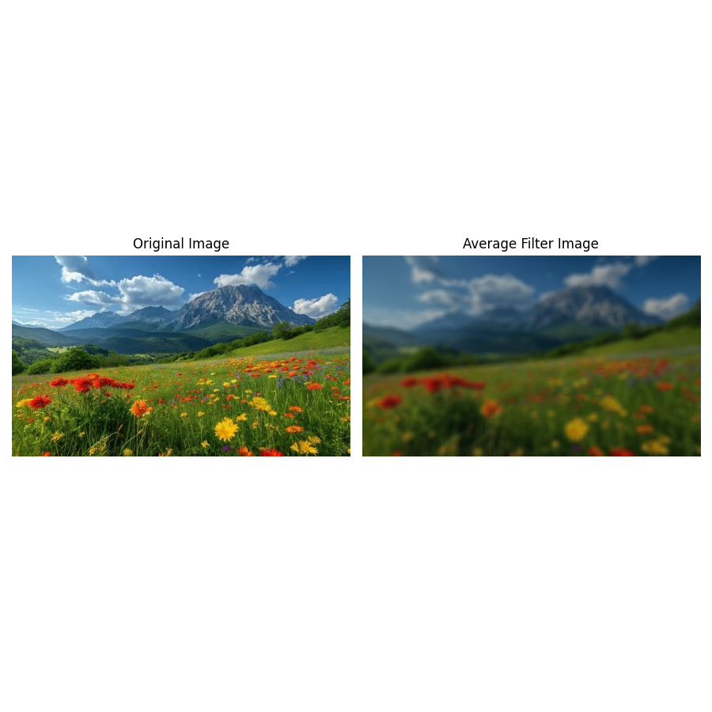
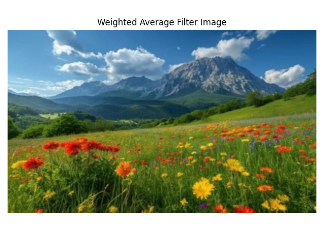
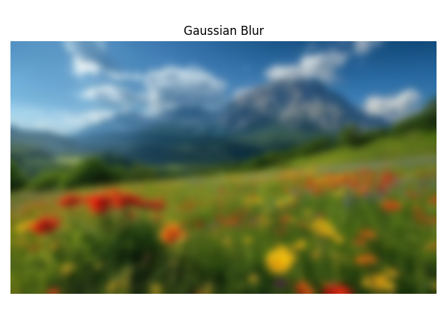
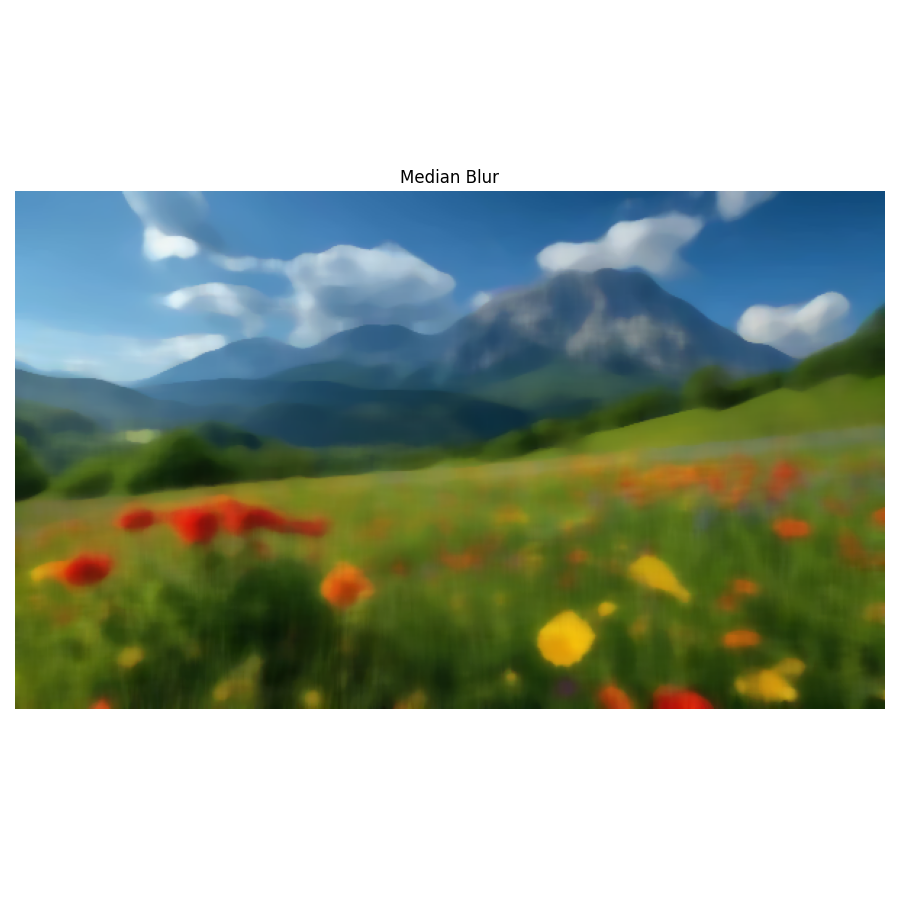
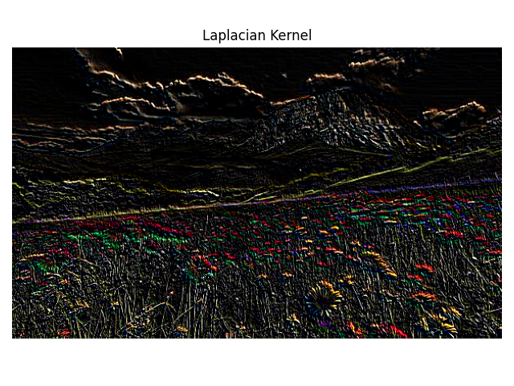
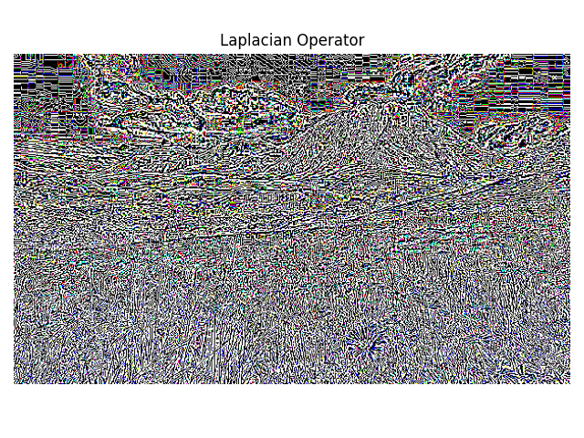

# Experiment 5: Image Smoothing and Sharpening Using OpenCV

**Name:** Mithik jain G  
**Register Number:** 212224240087  

---

## Aim:
To write a Python program using OpenCV to apply different smoothing filters (Averaging, Weighted Averaging, Gaussian, Median) and sharpening filters (Laplacian Kernel and Laplacian Operator) for image enhancement, and display each result separately along with the original image for comparison.

The program performs the following operations:
- Read and display an input image
- Apply Averaging filter
- Apply Weighted Averaging filter
- Apply Gaussian filter
- Apply Median filter
- Apply Laplacian sharpening using kernel
- Apply Laplacian operator
- Display all outputs for comparison

---

## 🛠️ Software Used:
- **Anaconda** – Python 3.7+
- **Jupyter Notebook / VS Code**
- **OpenCV (`cv2`)**
- **NumPy**
- **Matplotlib (`matplotlib.pyplot`)**

---

## ⚙️ Algorithm:

- **Step 1:** Import the required libraries: OpenCV, NumPy, and Matplotlib.
- **Step 2:** Read the input image (`jet.jpg` or `image.jpg`) using `cv2.imread()`.
- **Step 3:** Convert the image from BGR to RGB format using `cv2.cvtColor()` for Matplotlib display.
- **Step 4:** Apply Averaging Filter using a normalized box kernel with `cv2.filter2D()` or `cv2.blur()`.
- **Step 5:** Apply Weighted Averaging Filter using a custom weighted kernel with `cv2.filter2D()`.
- **Step 6:** Apply Gaussian Filter using `cv2.GaussianBlur()` with an appropriate kernel size and standard deviation.
- **Step 7:** Apply Median Filter using `cv2.medianBlur()` to eliminate noise while preserving sharp edges.
- **Step 8:** Apply Laplacian Sharpening using a linear kernel with `cv2.filter2D()` to accentuate fine details.
- **Step 9:** Apply Laplacian Operator using `cv2.Laplacian()` to detect edges and gradients.
- **Step 10:** Display all filtered images along with titles and axis settings for visual comparison.

---

## 💻 Program:

```python
# ==============================================================================
# Developed By: Mithik jain G
# Register No: 212224240087
# Experiment 5: Image Smoothing and Sharpening Using OpenCV
# ==============================================================================
```

### 1. Smoothing Filters

#### i) Using Averaging Filter
```python
import cv2
import matplotlib.pyplot as plt
import numpy as np

# Load the image and convert BGR to RGB
image1 = cv2.imread("jet.jpg")
image2 = cv2.cvtColor(image1, cv2.COLOR_BGR2RGB)

# Define averaging kernel and apply filter2D
kernel = np.ones((11, 11), np.float32) / 169
image3 = cv2.filter2D(image2, -1, kernel)

# Display Original Image and Averaging Filter Image
plt.figure(figsize=(9, 9))
plt.subplot(1, 2, 1)
plt.imshow(image2)
plt.title("Original Image")
plt.axis("off")

plt.subplot(1, 2, 2)
plt.imshow(image3)
plt.title("Average Filter Image")
plt.axis("off")
plt.show()
```

---

#### ii) Using Weighted Averaging Filter
```python
# Define weighted averaging kernel
kernel1 = np.array([[1, 2, 1], 
                    [2, 4, 2], 
                    [1, 2, 1]]) / 16

# Apply filter2D
image3 = cv2.filter2D(image2, -1, kernel1)

plt.imshow(image3)
plt.title("Weighted Average Filter Image")
plt.axis("off")
plt.show()
```

---

#### iii) Using Gaussian Filter
```python
# Apply Gaussian Blur
gaussian_blur = cv2.GaussianBlur(image2, (33, 33), 0, 0)

plt.imshow(gaussian_blur)
plt.title("Gaussian Blur")
plt.axis("off")
plt.show()
```

---

#### iv) Using Median Filter
```python
# Apply Median Blur
median = cv2.medianBlur(image2, 13)

plt.figure(figsize=(9, 9))
plt.imshow(median)
plt.title("Median Blur")
plt.axis("off")
plt.show()
```

---

### 2. Sharpening Filters

#### i) Using Laplacian Linear Kernel
```python
# Define Laplacian sharpening kernel
kernel2 = np.array([[-1, -1, -1], 
                    [ 2, -2,  1], 
                    [ 2,  1, -1]])

# Apply filter2D
image3 = cv2.filter2D(image2, -1, kernel2)

plt.imshow(image3)
plt.title("Laplacian Kernel")
plt.axis("off")
plt.show()
```

---

#### ii) Using Laplacian Operator
```python
# Apply Laplacian Operator
laplacian = cv2.Laplacian(image2, cv2.CV_64F)

plt.imshow(laplacian)
plt.title("Laplacian Operator")
plt.axis("off")
plt.show()
```

---

## Output:

### 1. Smoothing Filters

#### i) Averaging Filter
- Averaging filter computes the mean of neighboring pixels and produces a smoothed, blurred image.



---

#### ii) Weighted Averaging Filter
- Weighted averaging filter assigns higher weights to center pixels, providing a smoother result with reduced distortion.



---

#### iii) Gaussian Filter
- Gaussian filter uses a bell-shaped Gaussian distribution to effectively attenuate high-frequency noise while preserving key edge boundaries.



---

#### iv) Median Filter
- Median filter replaces each pixel with the median of neighboring pixels, effectively removing salt-and-pepper noise while maintaining edge crispness.



---

### 2. Sharpening Filters

#### i) Laplacian Kernel
- Laplacian kernel accentuates fine spatial transitions and significantly enhances edge sharpness and structural details.



---

#### ii) Laplacian Operator
- Second-order derivative Laplacian operator detects sharp intensity transitions and edge discontinuities clearly.



---

## Result:
Thus, smoothing filters and sharpening filters are successfully implemented using OpenCV.

The smoothing filters reduce noise and improve image quality, while sharpening filters enhance edges and details for better feature extraction.
